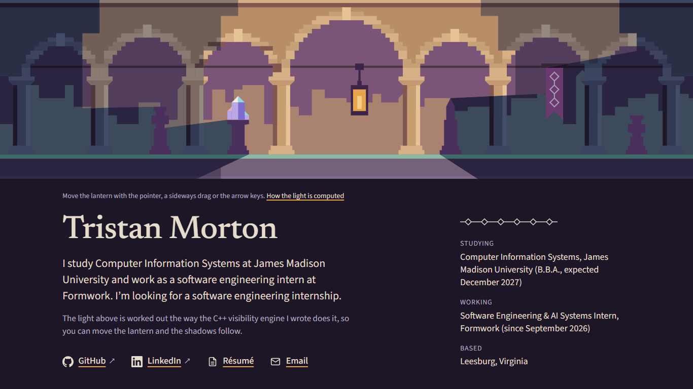
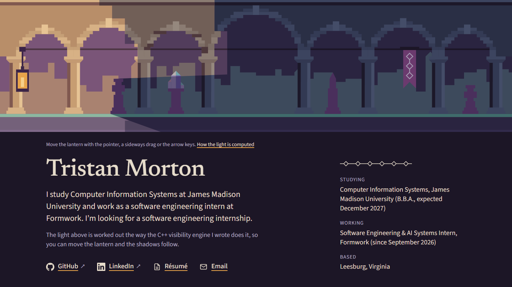

# Tristan Morton: portfolio site

A small static site: a home page with an interactive lantern scene, four project pages under `/work/<slug>/`, and a résumé PDF. Next.js 16 static export, React 19, TypeScript, plain CSS.



The scene is the site's one flourish. The lit area is a real visibility polygon (`src/lib/visibility.ts`), the same idea as my C++ lighting engine. It is computed at build time for the default lantern position, so the page is complete without JavaScript.

## Run

```
npm install
npm run dev        # http://localhost:3000
npm run build      # static export to out/
npm run check      # tsc --noEmit and eslint
npm test           # vitest: visibility function, contrast, content and résumé checks
```

## Where to edit

- Name, links and the production URL: `src/site.ts`. The URL lives only there; metadata, the sitemap, robots and the share image read it.
- Projects and the "More work" list: `src/content/projects.ts`. Images go in `public/work/<slug>/`.
- Experience, about and the home-page intro: `src/app/page.tsx`.
- The scene's shapes: `src/scene/geometry.ts`. Colours and spacing: `src/styles/tokens.css`.
- Résumé: replace `public/resume.pdf`.

The visual system is described in `docs/DESIGN.md`.

## Screenshots

In `docs/screenshots/`: the home page at 390x844, 1366x768 and 1920x1080, the full home page at 1366, a case study, and the hero with the lantern moved to the far left.



## Deploy

Vercel builds `npm run build` and serves `out/`. `vercel.json` holds the redirects for the old project URLs.
